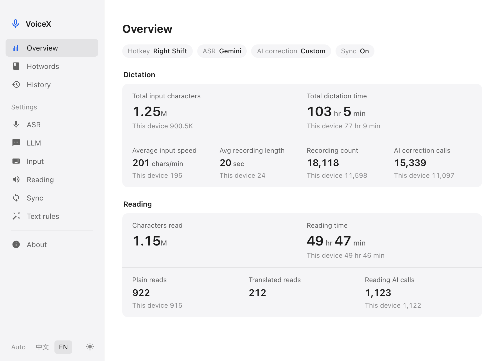
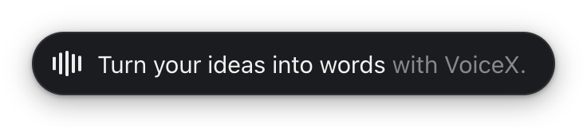
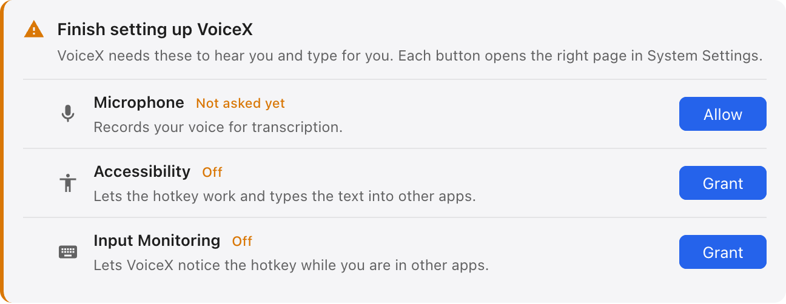
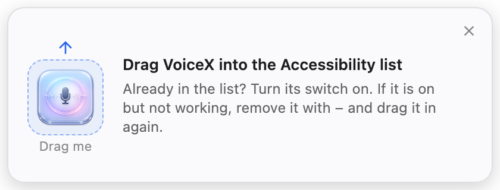
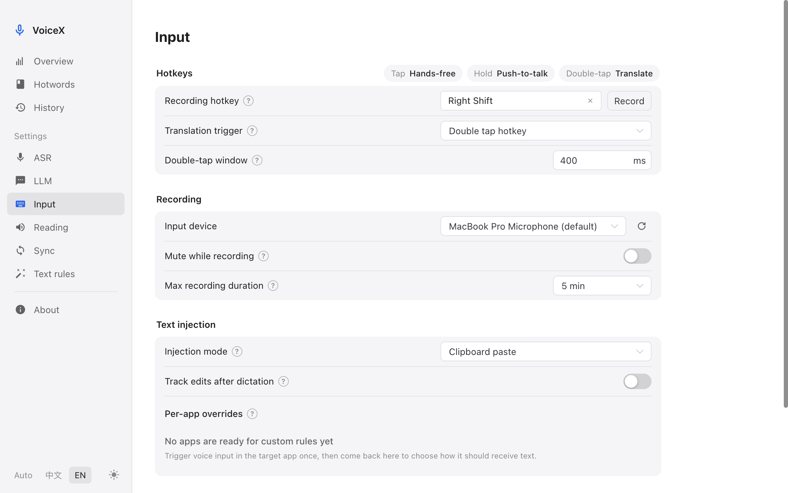
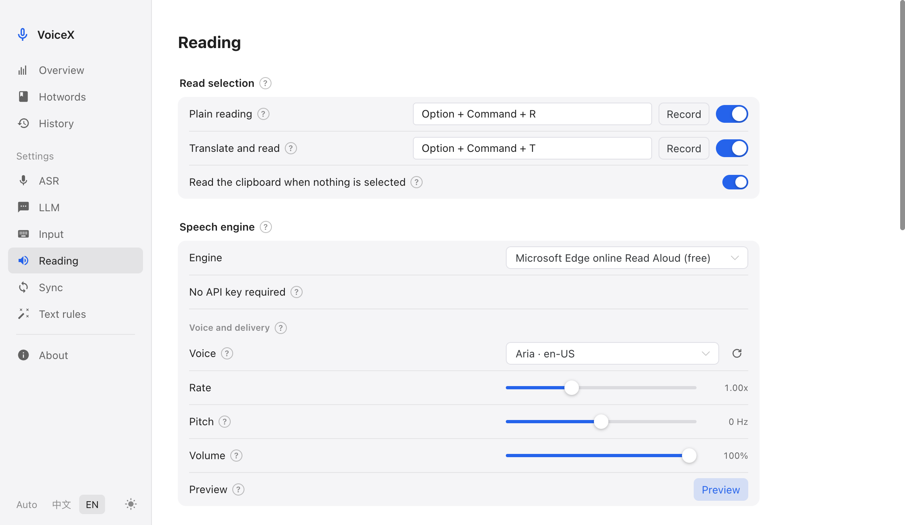
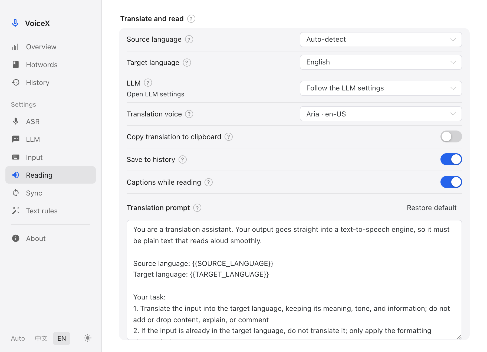
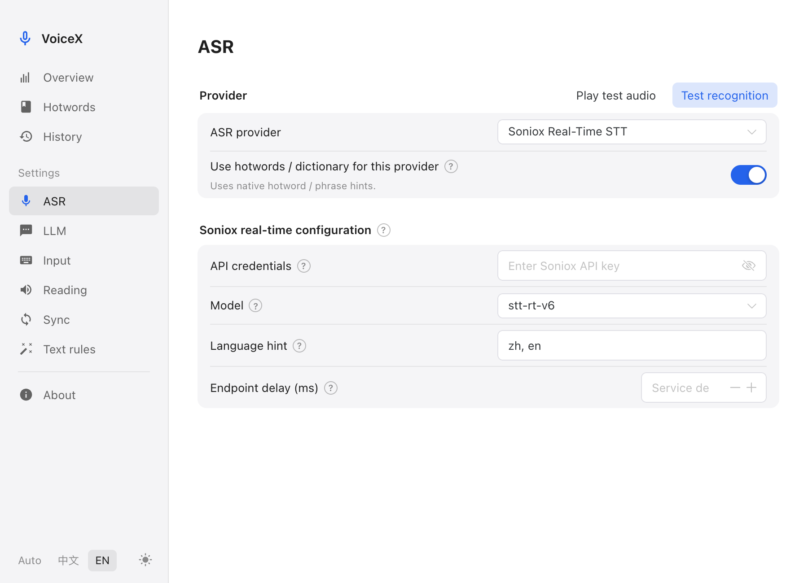
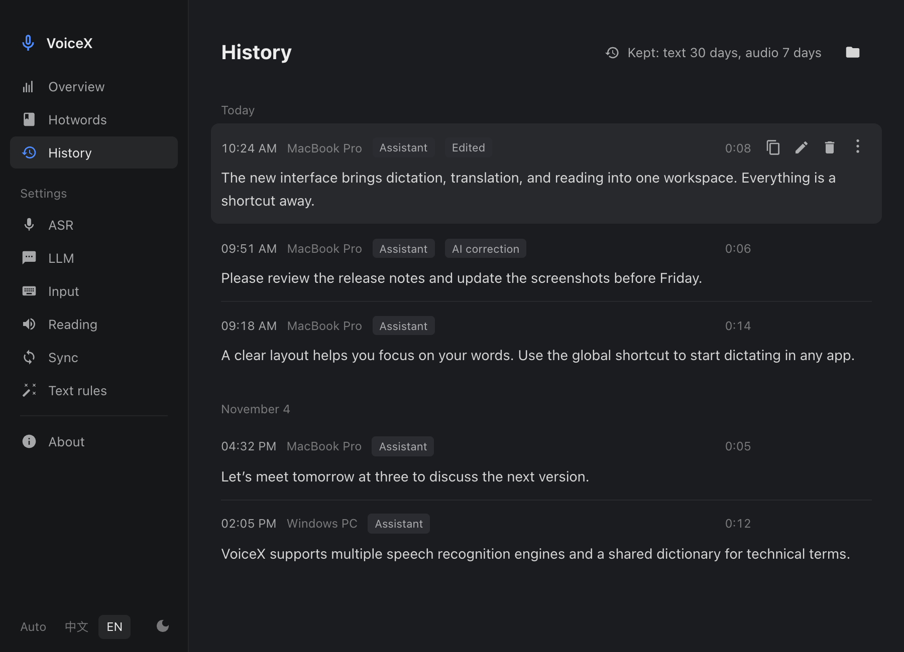

# VoiceX

English | [中文](./README.md)

<p align="center">
  
</p>

<p align="center">
  
</p>

VoiceX is a cross-platform voice workspace for your desktop: dictate, translate, and listen in any app. Press a hotkey and speak; the recognized text (optionally corrected or translated by an LLM) is typed into the app you are using and kept in your history. In the other direction, it reads selected text aloud, optionally translating it first.

Screenshots show the current interface. Overview uses real cumulative statistics; history, device names, and other settings are demo data, with no personal dictations or API keys.

## Highlights

- **Cross-platform** — macOS and Windows, with the interface, HUD, and tray menu in English and Chinese, and light, dark, or system appearance.
- **More than a dozen speech recognition engines** — switch between cloud and local engines to balance accuracy, latency, language coverage, and privacy.
- **One hotkey, three gestures** — tap for hands-free dictation, hold for push-to-talk, double-tap to translate.
- **Live HUD** — a small always-on-top window shows the transcript, recording mode, countdown, and processing status as you speak.
- **LLM post-processing** — optionally have an LLM correct or translate the result, with customizable prompts that use your dictionary.
- **Read and translate-and-read** — select text in any app; one hotkey reads it aloud, another translates it first, with sentence-by-sentence captions.
- **Smart text input** — paste through the clipboard (your clipboard is restored afterwards) or simulate typing, configurable per app.
- **History & statistics** — browse every dictation by date, edit the final text, replay audio, and re-transcribe with another engine.
- **Cross-device sync** — a self-hosted sync server shares history across your computers.

## Install

Download the latest version from [GitHub Releases](https://github.com/xuyungit/VoiceX/releases/latest).

**macOS (Apple Silicon)**

1. Open `VoiceX_x.y.z_aarch64.dmg` and drag VoiceX into Applications. VoiceX must run from `/Applications`; it will not start from anywhere else.
2. The app is signed with a local certificate and not notarized by Apple, so macOS blocks the first launch. Click **Open Anyway** under **System Settings → Privacy & Security**, or run:

   ```bash
   xattr -dr com.apple.quarantine /Applications/VoiceX.app
   ```

There is no Intel Mac build yet; you can [build from source](./docs/development.md).

**Windows (x64)**

Run `VoiceX_x.y.z_x64-setup.exe` (or the `.msi`). If SmartScreen warns about an unrecognized app, choose **More info → Run anyway**.

## First launch

### 1. Grant permissions

VoiceX needs system permissions to hear you and type for you. While any are missing, Overview shows a **Finish setting up VoiceX** card and the Overview item in the sidebar gets an orange dot:

<p align="center">
  
</p>

On macOS VoiceX needs three permissions:

| Permission | Used for | How to grant |
|---|---|---|
| **Microphone** | Recording your voice | Click **Allow** and accept the system prompt |
| **Accessibility** | Making the hotkey work and typing into other apps | Click **Grant** and drag VoiceX into the list |
| **Input Monitoring** | Noticing the hotkey while you are in other apps | Click **Grant** and drag VoiceX into the list |

**Grant** opens the matching page in System Settings, moves the VoiceX window out of the way, and shows a small window below System Settings. **Drag the VoiceX icon into the System Settings list**, confirm with Touch ID or your password if asked, and make sure the switch is on:

<p align="center">
  
</p>

Once the permission is on, the helper closes, VoiceX comes back, and the hotkey works right away, with no restart.

- If VoiceX is already in the list, just turn its switch on.
- If the switch is on but nothing works (for example after reinstalling), remove VoiceX with **−** below the list and drag it in again.
- In rare cases the card asks you to **Restart VoiceX**; click the button to finish.

Windows needs no extra permissions. The card appears only if Windows has turned off microphone access: click **Open Settings** and, under **Settings → Privacy & security → Microphone**, turn on **Microphone access** and **Let desktop apps access your microphone**.

### 2. Choose a speech recognition engine

On the **ASR** page, pick an engine and enter the API key from its provider (see [Speech recognition engines](#speech-recognition-engines)). To have an LLM correct or translate your dictation, also set up a provider on the **LLM** page.

### 3. Start dictating

The default dictation hotkey is **⌃⌥⌘ Space** (Windows: **Ctrl + Alt + Win + Space**); change it on the **Input** page. Put the cursor in any text field, tap the hotkey, and start speaking.

## Interaction modes

One hotkey, three gestures:

| Gesture | Mode | Behavior |
|---|---|---|
| **Tap** (press & release) | Hands-free | Records until a silence timeout or the maximum duration; no need to hold anything. |
| **Hold** (press & hold) | Push-to-talk | Records while the hotkey is held; release to finish. |
| **Double-tap** | Translate | Like hands-free, but an LLM translates the result to English (requires an LLM). |

The hold threshold and double-tap window are adjustable. Press **Escape** at any time to cancel and discard.

<p align="center">
  
</p>

**Mute while recording** (optional, off by default): enable it under Input → Microphone to mute the default system output while you dictate and restore it afterwards. Only the mute switch changes, not the volume, and players keep playing, so music no longer leaks into the microphone. Devices that were already muted are left alone; outputs that cannot be muted by software (such as HDMI on macOS) are flagged on the settings page.

## Reading and translate-and-read

Select text in **any application** and press a hotkey to hear it:

| Hotkey (configurable) | What it does |
|---|---|
| **⌥⌘R** Read (Windows: Ctrl + Alt + Win + R) | Reads the selection aloud |
| **⌥⌘T** Translate and read (Windows: Ctrl + Alt + Win + T) | An LLM translates the selection into the target language (English by default), then it is read aloud. Text already in the target language is tidied, not translated |

Press either reading key again, or **Escape**, to stop. You can also choose **Read Selection**, **Translate and Read**, or **Stop Reading** from the tray menu.

Engines that report progress show each sentence as a large caption:

<p align="center">
  
</p>

<p align="center">
  
</p>

Translate-and-read has its own target language, LLM, and voice options, plus switches for copying translations, keeping history, and showing captions:

<p align="center">
  
</p>

| | Detail |
|---|---|
| **What is read** | The selected text, read directly where possible; otherwise VoiceX simulates a copy and restores your clipboard afterwards (the "compatibility mode" Safari and VS Code need). With nothing selected, the clipboard's text is read instead and the HUD says so. Password fields and content a password manager hides are never read |
| **Captions** | On by default, up to two lines, above the Dock or taskbar. The system voice reports no progress, so it shows the compact HUD instead |
| **Translate and read** | Its own LLM choice and optional voices per target language. A failed translation is reported on the HUD and **never falls back to reading the untranslated text**. Source and translation are kept in local history by default (no audio, not synced), and the translation can also be copied to the clipboard |
| **Length limit** | Set separately for plain reading and translate-and-read under **Reading length**: unlimited, or 4K–128K characters (spaces and line breaks count; 1K = 1000 characters). Plain reading is unlimited by default, translate-and-read 16K. Text over the limit is reported on the HUD rather than truncated; tidy-before-reading uses the plain-reading limit |
| **Tidy before reading** (optional) | An LLM strips Markdown, HTML markup, and links first so only the prose is read; tables copied from web pages are read as sentences. If tidying fails, the original is read |
| **Yields to dictation** | Starting dictation stops reading, so the microphone never records the speech |

**Speech engines:**

- **System voice** (macOS only): offline with no setup; by default the voice from System Settings → Accessibility → Spoken Content.
- **Microsoft Edge online speech**: no account or key; the default on Windows.
- **Volcengine Doubao Seed-TTS 2.0**, **Alibaba Cloud Model Studio** (Qwen-Audio, Qwen3-TTS dialect voices, CosyVoice), **Xiaomi MiMo**, **Microsoft Azure Speech**.

Cloud engines stream, so speech starts about half a second after the hotkey, and long selections are synthesized sentence by sentence. Voice, rate, and volume are saved per engine and can be previewed; some Alibaba Cloud models also accept a one-line description of the speaking style.

**Windows:** there is no system voice, so Edge online speech is the default. Apps running as administrator cannot be read unless VoiceX also runs as administrator.

### How this differs from macOS "Speak selection"

macOS has a built-in equivalent (System Settings → Accessibility → Spoken Content, Option + Esc by default). The two can coexist, and the default hotkeys do not collide. VoiceX differs in that:

- **It can use cloud voices.** The built-in feature only uses local voices, and every local Chinese voice available to third-party apps is the compact tier; the built-in feature sounds better by default because it uses Siri voices, which third-party apps cannot use.
- **Settings are saved per engine**, with a preview so you can listen before deciding.
- **It shares one hotkey system with dictation**, so conflicts are flagged on the settings page.

The built-in feature does things VoiceX does not: word-by-word highlighting, and working in places such as the login window.

### Export MP3 from the command line

`voicex-tts` turns a text or Markdown file into an MP3 using the desktop app's saved speech engine, voice, and LLM settings. It currently runs from source:

```bash
# Use Edge online speech directly, without an LLM
cargo run --manifest-path src-tauri/Cargo.toml --bin voicex-tts -- notes.md --tts edge --no-llm

# Translate to English with the configured reading LLM and save the prepared text
cargo run --manifest-path src-tauri/Cargo.toml --bin voicex-tts -- notes.md --translate --to en --save-text notes.en.txt -o notes.en.mp3
```

The output defaults to the input filename plus `.mp3` (such as `notes.md.mp3`); see `--help` for all options. If the desktop app uses the system voice, export uses Edge instead. The target file is replaced only after synthesis succeeds, so a failed export keeps any existing file.

### Where the text goes

- On macOS the default **system voice runs entirely on your Mac**; the text never leaves it. On Windows the default Edge online speech sends the text to Microsoft's online service.
- With a cloud engine selected, **the text being read is sent to that provider** for synthesis; the settings page says so.
- Translate-and-read and tidy-before-reading also send the text to the chosen LLM provider.
- Plain reads store **no** text or audio. Translate-and-read keeps the source and translation in local history by default (this can be switched off), never uploaded by sync. Logs record lengths, the target app, and error codes, never the text.

## Speech recognition engines

Choose an engine and model and adjust its parameters on the **ASR** page; each parameter has a help icon next to it.

<p align="center">
  
</p>

| Engine | Mode | Notes |
|---|---|---|
| Volcengine (Doubao Speech) | Cloud realtime | Optimized for Chinese; hot words, number formatting, punctuation |
| Google Cloud Speech-to-Text V2 | Cloud realtime | Many languages, phrase boost |
| Fun-ASR Realtime | Cloud realtime | Alibaba Cloud Model Studio; low latency; some models use the dictionary as context |
| Qwen (Model Studio ASR) | Cloud realtime / after recording | New `qwen-audio-3.1/3.0-asr-flash` models and Qwen3-ASR; 3.1 costs roughly 60–90% less than 3.0; hot words with weights, context, and an optional full-recording refinement after realtime; after-recording mode is limited to 5 minutes |
| Google Gemini | Cloud realtime / after recording | Realtime defaults to `gemini-3.5-transcribe-live` (up to 10 minutes); `gemini-3.8-live` may return text only after recording and incur audio output charges. After-recording mode defaults to `gemini-3.5-flash-lite` |
| Cohere | After recording | `cohere-transcribe-03-2026`; requires a language |
| Soniox | Cloud realtime | Default `stt-rt-v6`; hot words and language hints |
| StepAudio (StepFun) | After recording | Default `stepaudio-3-asr-max`; recordings up to 30 minutes |
| Xiaomi MiMo | After recording | `mimo-v2.5-asr` |
| OpenAI | Cloud realtime / after recording | `gpt-live-transcribe` / `gpt-transcribe`; the dictionary is sent as keywords; multiple languages |
| ElevenLabs | Cloud realtime / after recording | `scribe_v2_realtime` / `scribe_v2`; optional full-recording refinement after realtime; the dictionary is sent only after recording, not during realtime |
| [Coli](https://www.npmjs.com/package/@marswave/coli) | Local, offline | SenseVoice / Whisper based; installed separately |
| Qwen3-ASR (Local) | Local, offline | Alibaba's open-weight model, fully offline; see below |

Doubao, Qwen, ElevenLabs, Soniox, and Coli are currently recommended, but results vary from person to person: pronunciation, wording, and domain vocabulary all play a part.

- Cloud engines need an API key from their provider. Realtime recognition follows your system proxy settings.
- Models a provider retires are removed from the presets. Saved settings move to the provider's corresponding model automatically; those that cannot be moved safely are kept and flagged on the settings page so you can choose another.

### Local offline recognition (Qwen3-ASR)

Runs entirely on your machine; audio never leaves the device (not available on Windows). It needs the `qwen-asr` command-line tool and a model download.

**1. Install the command-line tool** (requires the [Rust toolchain](https://rustup.rs/)):

```bash
cargo install qwen-asr-cli
```

**2. Download the model** (about 1.9 GB):

```bash
qwen-asr download qwen3-asr-0.6b --output ~/models
```

If the download breaks off partway, a resumable transfer is more reliable:

```bash
curl -L -C - --retry 8 -o ~/models/qwen3-asr-0.6b/model.safetensors "https://huggingface.co/Qwen/Qwen3-ASR-0.6B/resolve/main/model.safetensors"
```

**3. Configure it**: on the ASR page choose **Qwen3-ASR (Local)** and set "Model Directory" to the path from step 2 (such as `~/models/qwen3-asr-0.6b`). Leave the command path blank to find it automatically.

Worth knowing:

- **Force Language defaults to Chinese; keep it set.** With auto-detect, the model may switch to English output partway through a sentence.
- **The dictionary is on by default** and clearly helps with proper nouns. It is passed in the model's prompt, so it can occasionally over-match; only the first 60 entries are used.
- Text appears after you release the hotkey, usually within a second for short sentences. Spoken numbers are not converted to digits.

## LLM

Optionally have an LLM correct or translate the recognized text. Choose a provider and enter its API key on the **LLM** page:

| Provider | Default model |
|---|---|
| Volcengine (Doubao) | `doubao-seed-2-0-mini-260428` |
| OpenAI (or compatible) | `gpt-6-luna` |
| Qwen (Model Studio) | `qwen3.5-flash` |
| DeepSeek | `deepseek-flash` |
| Google Gemini | `gemini-3.5-flash-lite` |
| Anthropic (Claude, or any compatible endpoint) | `claude-haiku-5-5` |
| Custom | Any OpenAI-compatible endpoint |

- **Correction** — fixes recognition errors using your dictionary, with customizable prompts (`{{DICTIONARY}}` inserts the word list).
- **Translation** — double-tap the hotkey to translate the result to English.
- **Connection test** — sends one real correction request with the current provider and model so you can check speed and quality.
- **Recent input context** — optionally passes your last five inputs as reference, preferring edited versions.
- **Lowest reasoning by default** — short corrections gain nothing from "thinking", so it is turned down to save time; the settings page shows exactly what is sent. A reply cut off at the output limit is reported as an error instead of being used.

## Dictionary and replacement rules

- **Dictionary** — one word per line. Speech recognition passes it to an engine as hints only when **Use hotwords / dictionary for this provider** is on for that engine on the ASR page. The switch is saved per engine and is on by default, except for Google Gemini, where it starts off because the model can echo the word list during silence. Cohere, Xiaomi MiMo, and Coli do not take a dictionary. LLM correction uses the dictionary regardless of this switch.
- **Replacement rules** — exact, contains, or regex rules applied to the text before it is typed; exact matches ignore trailing punctuation.
- **Short-sentence punctuation** — trailing punctuation is removed from short sentences, with an adjustable length threshold.

## Text input

- Paste through the clipboard (your clipboard is restored afterwards) or simulate typing.
- Configure per app: keep pasting in ordinary text fields and switch to typing in editors that handle paste differently.
- Text goes to the app in front when typing starts, so you can switch apps while recognition runs.

## History & statistics

<p align="center">
  
</p>

- Browse every dictation by date: replay audio, copy, view details, and compare the original recognition with the LLM-corrected text.
- Edit the final text directly; edited entries are marked "Edited" and copying uses your edit. Edits stay on this device.
- Turn on **Track edits after dictation** under Input to briefly watch for your follow-up edits in supported apps and compare both versions under **History → Edits** (off by default).
- Translate an entry into English and copy the translation.
- Re-transcribe any recording with another engine to compare results, or type the result into the current app again.
- Recordings whose recognition failed are kept so you can retry later instead of dictating again.
- Keep text and audio for 7 / 30 / 180 / 365 days or forever.
- Overview totals dictation and reading: volume, time, speed, and AI calls, for your account and for this device.

## Cross-device sync

If you dictate on several computers, a lightweight self-hosted sync server (`sync-server/`) keeps your text history consistent across them; audio stays on each device. The server needs few resources; see [sync-server/README.md](./sync-server/README.md) for setup.

## Known limitations

- The macOS build is Apple Silicon only and not notarized by Apple.
- These Windows features have not been fully tested on a real machine: mute while recording, tray reading, caption click-through, and tracking edits after dictation.
- Local Qwen3-ASR is not available on Windows.

## Building from source

See [docs/development.md](./docs/development.md) for prerequisites, builds, local signing, and the project layout.

## License

This project is licensed under the [MIT License](./LICENSE). Third-party component licenses are listed in [THIRD_PARTY_LICENSES](./THIRD_PARTY_LICENSES).
