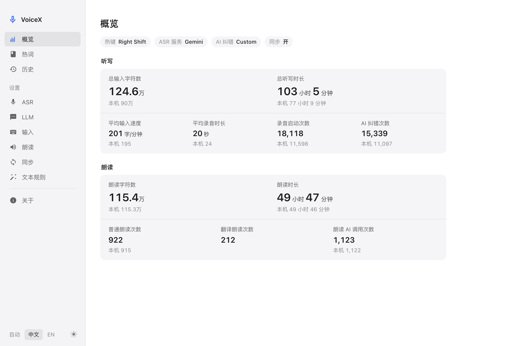
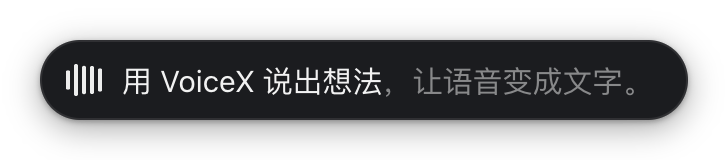
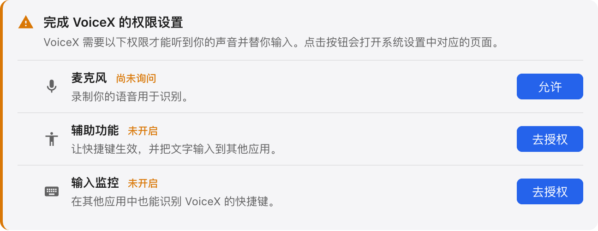
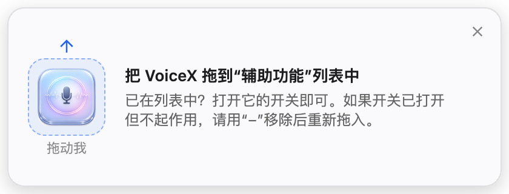
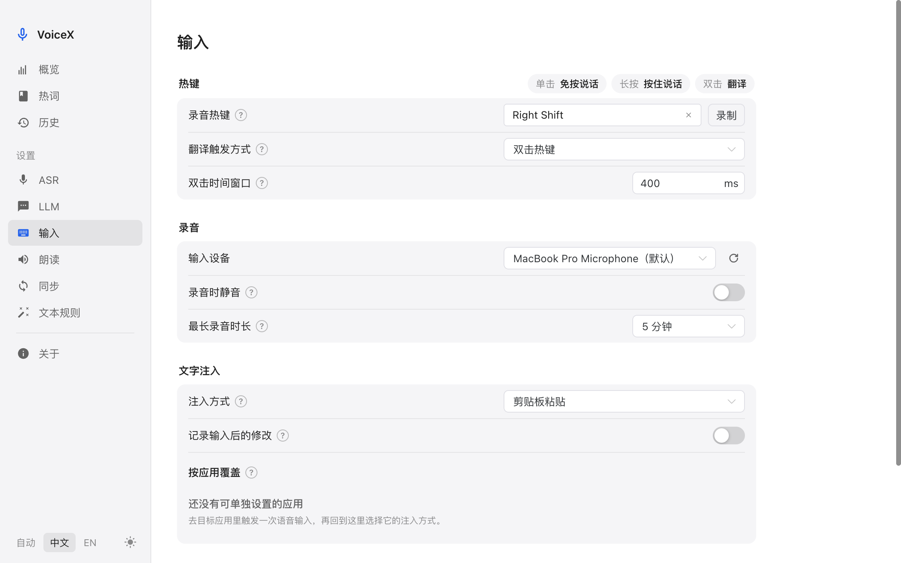
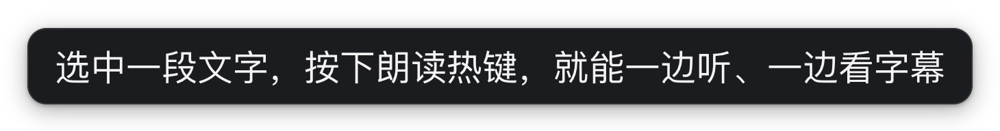
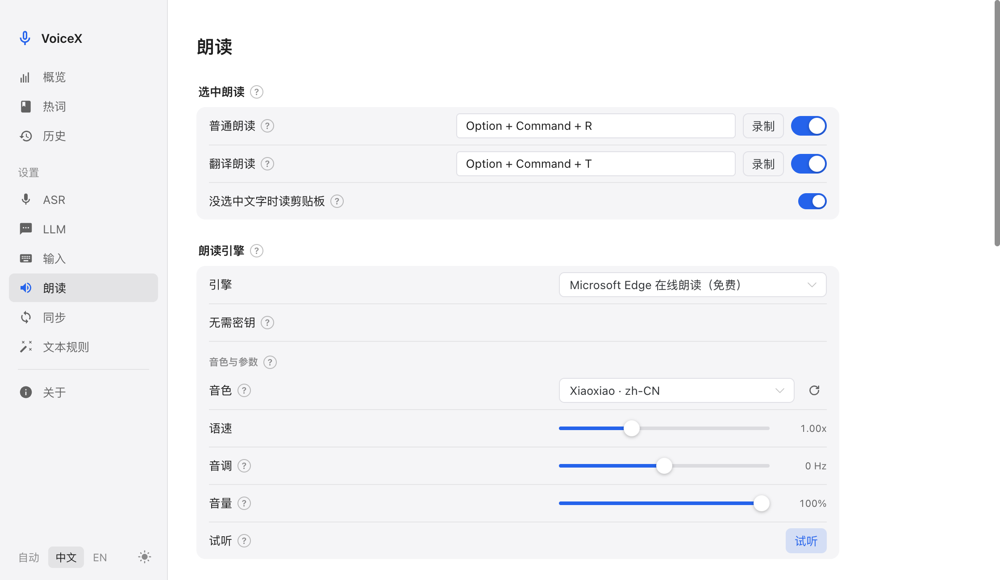
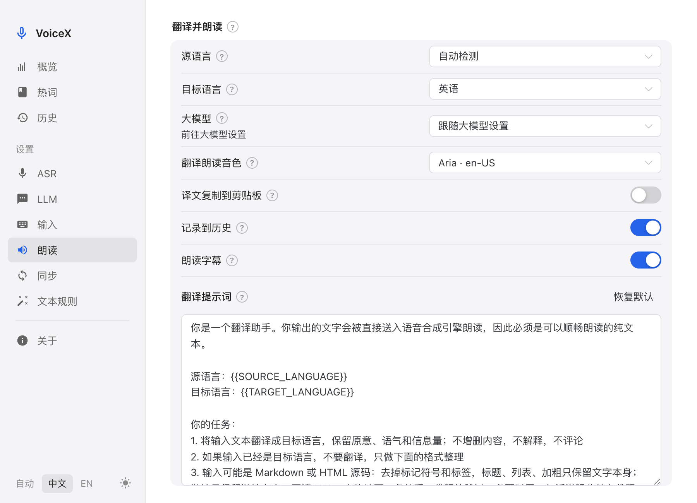
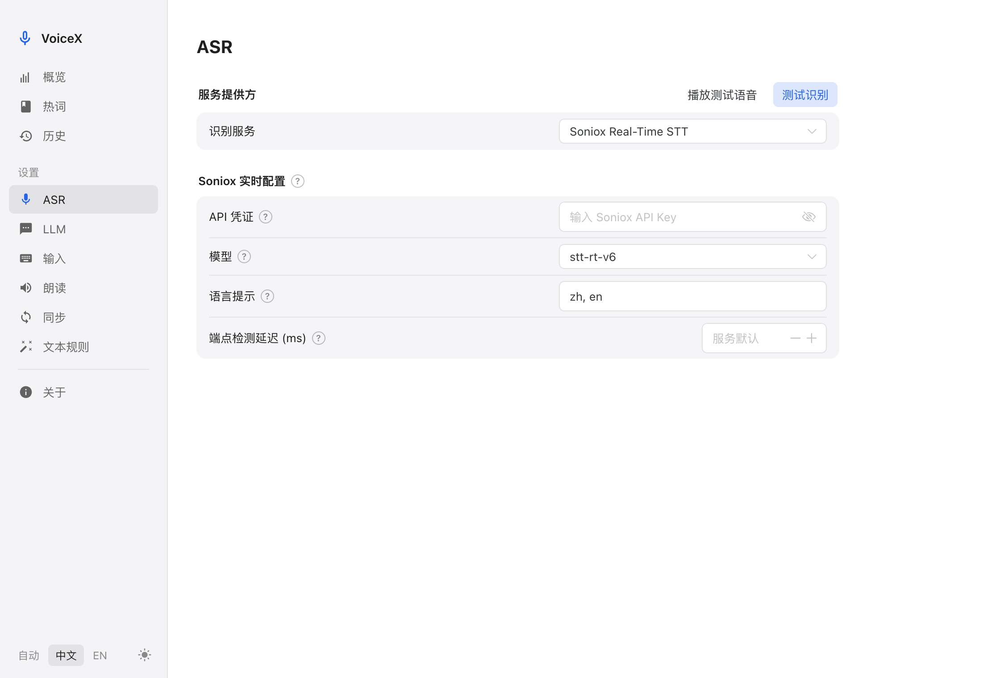
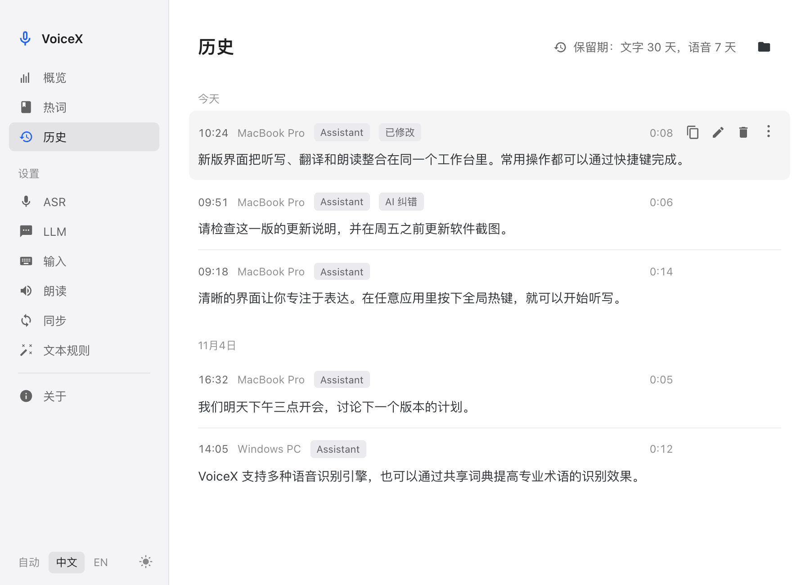

# VoiceX

[English](./README.en.md) | 中文

<p align="center">
  <picture>
    <source media="(prefers-color-scheme: dark)" srcset="assets/screenshots/zh/main-window-dark.png" />
    
  </picture>
</p>

<p align="center">
  
</p>

VoiceX 是一个跨平台的桌面语音工作台，在任意应用里说、译、听：按下热键说话，识别结果（可选经大模型纠错或翻译）直接输入到当前应用，并保存到历史记录；反过来，选中的文字也可以直接读出来，或先翻译再朗读。

截图来自当前版本界面：概览为真实的累计统计，历史、设备名称和其他设置均为示例数据，不含个人听写内容或 API 密钥。

## 亮点

- **跨平台** — 支持 macOS 和 Windows，界面、HUD、托盘菜单均提供中文和英文，并可选浅色、深色或跟随系统。
- **十余种语音识别引擎** — 云端和本地引擎自由切换，兼顾准确率、延迟、语种和隐私。
- **一键多用** — 一个全局热键：轻点免提听写，长按按住说话，双击翻译。
- **实时 HUD** — 置顶小窗实时显示转写文字、录音模式、倒计时和处理状态。
- **大模型后处理** — 可选让大模型纠错或翻译识别结果，提示词可自定义，并会参考你的词典。
- **朗读与翻译朗读** — 在任意应用选中文字，一个热键读出来，另一个热键先翻译再读，并逐句显示字幕。
- **智能输入** — 通过剪贴板粘贴（自动恢复原剪贴板）或模拟键入，可按应用分别设置。
- **历史与统计** — 按日期浏览每次听写，可编辑最终文本、回放录音、换引擎重新识别。
- **跨设备同步** — 自建同步服务器，多台电脑共享历史记录。

## 安装

从 [GitHub Releases](https://github.com/xuyungit/VoiceX/releases/latest) 下载最新版本。

**macOS（Apple Silicon）**

1. 打开 `VoiceX_x.y.z_aarch64.dmg`，把 VoiceX 拖到「应用程序」。VoiceX 必须从 `/Applications` 启动，放在其他位置时不会运行。
2. 安装包使用本地证书签名，未经 Apple 公证，首次打开会被系统拦截。到 **系统设置 → 隐私与安全性** 点击「仍要打开」，或在终端执行：

   ```bash
   xattr -dr com.apple.quarantine /Applications/VoiceX.app
   ```

Intel Mac 暂无安装包，可[从源码构建](./docs/development.md)。

**Windows（x64）**

运行 `VoiceX_x.y.z_x64-setup.exe`。如果 SmartScreen 提示无法识别的应用，点击「更多信息 → 仍要运行」。以前通过 MSI 安装的用户需先卸载旧版，再安装 EXE，才能使用应用内更新。

**应用内更新**

正式版可在「关于」或托盘菜单检查并安装更新。更新优先从镜像下载，并验证签名；安装前会确认听写、朗读和历史处理等工作已结束。Apple Silicon Mac 的本地识别引擎随应用更新，已下载的模型会保留。

## 首次启动

### 1. 授予权限

VoiceX 需要系统权限才能听到你的声音并替你输入。缺少权限时，概览页顶部会出现「完成 VoiceX 的权限设置」卡片，侧栏的「概览」旁也会显示一个橙色圆点：

<p align="center">
  <picture>
    <source media="(prefers-color-scheme: dark)" srcset="assets/screenshots/zh/permission-setup-dark.png" />
    
  </picture>
</p>

macOS 上需要三项权限：

| 权限 | 用途 | 怎么授予 |
|---|---|---|
| **麦克风** | 录音 | 点击「允许」，在系统弹窗中同意 |
| **辅助功能** | 让快捷键生效，并把文字输入到其他应用 | 点击「去授权」，把 VoiceX 拖进列表 |
| **输入监控** | 在其他应用中也能识别快捷键 | 点击「去授权」，把 VoiceX 拖进列表 |

点击「去授权」后，系统设置会直接打开对应的页面，VoiceX 主窗口暂时让开，系统设置下方出现一个小窗口。把其中的 VoiceX 图标**拖进系统设置的列表**，按提示用触控 ID 或密码确认，并确保开关已打开：

<p align="center">
  
</p>

授权完成后小窗自动关闭，VoiceX 回到前台，快捷键立即可用，无需重启。

- 如果 VoiceX 已在列表中，打开它的开关即可。
- 如果开关已打开但不起作用（例如重新安装后），用列表下方的「−」移除 VoiceX，再重新拖入。
- 极少数情况下卡片会提示「重启以完成设置」，点击「重启 VoiceX」即可。

Windows 不需要额外授权。只有当系统关闭了麦克风权限时才会出现提示卡片，点击「打开设置」，在 **设置 → 隐私和安全性 → 麦克风** 中打开「麦克风访问权限」和「允许桌面应用访问你的麦克风」。

### 2. 选择语音识别引擎

在 **ASR** 页选择一个识别引擎并填入对应平台的 API Key（引擎列表见[语音识别引擎](#语音识别引擎)）。如果想让大模型纠错或翻译，再到 **LLM** 页配置一个提供商。

### 3. 开始听写

默认听写热键在 macOS 上是 **右侧 Command**（Windows：**Ctrl + Alt + Win + Space**），可在 **输入** 页修改。光标放在任意输入框，轻点热键开始说话。

## 交互模式

一个热键对应三种操作：

| 手势 | 模式 | 行为 |
|---|---|---|
| **轻点**（按下即松） | 免提听写 | 持续录音直到静音超时或达到最长时长，无需一直按住。 |
| **长按**（按住不放） | 按住说话 | 按住期间录音，松开即结束。 |
| **双击** | 翻译 | 与免提听写相同，但结果由大模型翻译为英文（需配置 LLM）。 |

长按阈值和双击间隔均可调。录音期间按 **Escape** 可随时取消并丢弃。

<p align="center">
  <picture>
    <source media="(prefers-color-scheme: dark)" srcset="assets/screenshots/zh/input-settings-dark.png" />
    
  </picture>
</p>

**录音时静音**（可选，默认关闭）：在「输入 → 麦克风」开启后，录音期间会把系统默认输出静音，结束后恢复。只切换静音开关、不改音量，播放器继续播放，音乐不会被录进去。本来就静音的设备不受影响；无法软件静音的设备（如 macOS 上的 HDMI 输出）会在设置页提示。

## 朗读与翻译朗读

在**任意应用**里选中一段文字，按热键即可朗读：

| 热键（可改） | 作用 |
|---|---|
| **⌥⌘R** 朗读（Windows：Ctrl + Alt + Win + R） | 读出选中的文字 |
| **⌥⌘T** 翻译朗读（Windows：Ctrl + Alt + Win + T） | 先由大模型翻译成目标语言（默认英文）再朗读；已经是目标语言的文本只做整理、不翻译 |

再按一次任一朗读热键或按 **Escape** 立即停止。也可以从托盘菜单选择「朗读所选内容」「翻译并朗读」或「停止朗读」。

支持进度回报的引擎会逐句显示大字幕：

<p align="center">
  
</p>

<p align="center">
  <picture>
    <source media="(prefers-color-scheme: dark)" srcset="assets/screenshots/zh/reading-settings-dark.png" />
    
  </picture>
</p>

翻译朗读可以单独选择目标语言、大模型和译文音色，并设置是否复制译文、保存历史或显示字幕：

<p align="center">
  <picture>
    <source media="(prefers-color-scheme: dark)" srcset="assets/screenshots/zh/translate-reading-settings-dark.png" />
    
  </picture>
</p>

| | 说明 |
|---|---|
| **读什么** | 优先直接读取选中的文字；读不到时模拟一次复制，读完后恢复剪贴板（「取词兼容模式」，Safari、VS Code 需要它）。没有选中内容时改读剪贴板里的文字，HUD 会注明。密码框和密码管理器隐藏的内容不会被读 |
| **字幕** | 默认开启，最多两行，显示在 Dock 或任务栏上方。系统语音不回报进度，只显示紧凑的 HUD |
| **翻译朗读** | 大模型可单独选择；可按目标语言指定译文音色。翻译失败时在 HUD 上报错，**不会退回去朗读原文**。原文和译文默认保存在本机历史（不保存音频，不参与同步），也可以把译文复制到剪贴板 |
| **长度上限** | 在「朗读长度」中分别设置普通朗读和翻译朗读的上限：不限，或 4K–128K 字符（按字符计，空格和换行也算；1K = 1000 字符）。普通朗读默认不限，翻译朗读默认 16K。超过上限时 HUD 会提示，不会截断后朗读；「朗读前整理」使用普通朗读的上限 |
| **朗读前整理**（可选） | 先让大模型去掉 Markdown、HTML 标记和链接，只读正文；网页上复制的表格会读成完整句子。整理失败时照读原文 |
| **与听写互斥** | 开始听写时朗读自动停止，避免朗读声被麦克风录进去 |

**朗读引擎：**

- **系统语音**（仅 macOS）：离线、免配置，默认使用「系统设置 → 辅助功能 → 朗读内容」中的声音。
- **Microsoft Edge 在线朗读**：无需账号和密钥，Windows 上的默认引擎。
- **火山引擎豆包 Seed-TTS 2.0**、**阿里云百炼**（Qwen-Audio、Qwen3-TTS 方言音色、CosyVoice）、**小米 MiMo**、**Microsoft Azure Speech**。

云端引擎均为流式合成，按下热键约 0.5 秒后开始出声，长文本按句连续合成。每个引擎的音色、语速、音量独立保存，可先试听；部分阿里云模型还支持用一句话描述朗读风格。

**Windows：** 没有系统语音，默认使用 Edge 在线朗读。以管理员身份运行的应用读不到选中文字，除非 VoiceX 也以管理员身份运行。

### 与 macOS 自带「朗读所选内容」的差异

macOS 自带同类功能（系统设置 → 辅助功能 → 朗读内容，默认 Option + Esc），两者可以共存，默认热键互不冲突。VoiceX 的不同在于：

- **可以使用云端音质**。系统功能只能用本机音色，第三方应用可用的中文本机音色都是精简档；系统功能默认听起来更好，是因为它使用了不对第三方开放的 Siri 音色。
- **参数按引擎独立保存**，可以试听后再决定。
- **与听写共用一套热键**，冲突会在设置页直接标出。

系统功能也有 VoiceX 不做的：逐词高亮，以及在登录界面等位置工作。

### 命令行导出 MP3

`voicex-tts` 可以把文本或 Markdown 文件合成为 MP3，复用桌面端保存的朗读引擎、音色和大模型设置。目前需要从源码运行：

```bash
# 直接使用 Edge 在线语音，不经过大模型
cargo run --manifest-path src-tauri/Cargo.toml --bin voicex-tts -- notes.md --tts edge --no-llm

# 使用已配置的朗读大模型翻译成英文，并保留处理后的文本
cargo run --manifest-path src-tauri/Cargo.toml --bin voicex-tts -- notes.md --translate --to en --save-text notes.en.txt -o notes.en.mp3
```

默认输出为输入文件名加 `.mp3`（如 `notes.md.mp3`），完整选项见 `--help`。桌面端选择系统语音时，导出改用 Edge。合成全部成功后才替换目标文件，失败时保留原文件。

### 数据去向

- macOS 默认的**系统语音完全在本机运行**，文字不出设备。Windows 默认的 Edge 在线朗读会把文字发给微软在线服务。
- 选择云端引擎后，**要读的文字会发送给该服务商**合成；设置页会明确提示。
- 翻译朗读和朗读前整理还会把文字发给所选的大模型提供商。
- 普通朗读**不保存**文本和音频；翻译朗读默认把原文和译文保存在本机历史（可关闭），不会上传同步服务器。日志只记录长度、目标应用和错误码，不记录文本内容。

## 语音识别引擎

在 **ASR** 页切换引擎、选择模型并调整参数，参数说明可通过旁边的帮助图标查看。

<p align="center">
  <picture>
    <source media="(prefers-color-scheme: dark)" srcset="assets/screenshots/zh/asr-settings-dark.png" />
    
  </picture>
</p>

| 引擎 | 方式 | 说明 |
|---|---|---|
| 火山引擎（豆包语音） | 云端实时 | 中文优化；支持热词、数字规整、标点 |
| Google Cloud Speech-to-Text V2 | 云端实时 | 多语种，支持短语增强 |
| Fun-ASR Realtime | 云端实时 | 阿里云百炼；低延迟；部分模型可使用词典作为上下文 |
| 通义千问（百炼 ASR） | 云端实时 / 录完识别 | 新一代 `qwen-audio-3.1/3.0-asr-flash` 与 Qwen3-ASR；3.1 比 3.0 便宜约六到九成；支持热词与权重、上下文、实时识别后再整段精修；录完识别单次最长 5 分钟 |
| Google Gemini | 云端实时 / 录完识别 | 实时默认 `gemini-3.5-transcribe-live`（最长 10 分钟）；`gemini-3.8-live` 可能在录音结束后才出字，并产生语音输出费用。录完识别默认 `gemini-3.5-flash-lite` |
| Cohere | 录完识别 | `cohere-transcribe-03-2026`；需指定语言 |
| Soniox | 云端实时 | 默认 `stt-rt-v6`；支持热词和语言提示 |
| StepAudio（阶跃星辰） | 录完识别 | 默认 `stepaudio-3-asr-max`；单次录音最长 30 分钟 |
| 小米 MiMo | 录完识别 | `mimo-v2.5-asr` |
| OpenAI | 云端实时 / 录完识别 | `gpt-live-transcribe` / `gpt-transcribe`；词典作为关键词传入；支持多语种 |
| ElevenLabs | 云端实时 / 录完识别 | `scribe_v2_realtime` / `scribe_v2`；可在录音结束后整段精修；词典只在录完识别时传入，实时阶段不使用 |
| [Coli](https://www.npmjs.com/package/@marswave/coli) | 本地离线 | 基于 SenseVoice / Whisper，需单独安装 |
| Qwen3-ASR（本地） | 本地离线 | 阿里开源模型，完全离线；见下文 |

目前推荐豆包、通义千问、ElevenLabs、Soniox 和 Coli，但体验因人而异，发音习惯、用词和使用领域都会影响效果。

- 云端引擎需要到对应平台申请 API Key。实时识别会使用系统代理设置。
- 服务商下线的模型会从预设中移除：已保存的配置会自动迁移到同一服务商的对应模型；无法安全迁移的会保留并在设置页提示手动选择。
- Coli 可在 ASR 设置中指定 SenseVoice 模型目录或 ONNX 文件的绝对路径，旁边需有配套的 `tokens.txt`；留空仍使用 coli 默认模型。自定义模型和指定语言需要 coli **0.0.20 或更新版本**，适用于实时识别、Batch 和 SenseVoice 录后精修，不影响 Whisper。`2025-09-09` 版侧重粤语且不支持标点，需自行下载后指定路径。

### 本地离线识别（Qwen3-ASR）

仅支持 **Apple Silicon Mac**，音频在本机识别，不离开设备。VoiceX 安装包自带 `qwen-asr` 引擎，无需安装 Rust 或命令行工具，也不使用系统中已有的引擎。Windows 和 Intel Mac 暂不支持。

在 **ASR → Qwen3-ASR（本地）** 中选择模型和下载源，下载完成后即可使用：

- **0.6B（推荐）**：下载约 1.88 GB；**1.7B**：下载约 4.70 GB。首次识别还会生成缓存，界面显示模型、缓存及未完成下载的总占用。
- **ModelScope（魔搭）和 Hugging Face** 提供相同模型。支持暂停、退出应用后续传，以及暂停后切换下载源续传；完整文件会校验 SHA-256。
- 在“更多”中可重新下载、清理未完成下载或删除模型。删除同时清理其缓存；重新下载完成前保留现有可用模型。
- 引擎随 VoiceX 更新；模型存放于应用数据目录，更新应用时保留，不单独检查模型升级。

以前自行配置的模型目录不会自动导入，请在设置页下载所需模型。

强制语种默认中文，建议保持；自动检测可能在句子中途切换为英文。词典默认开启，通过提示词传给模型，只使用前 60 条。松开热键后整段出字，口述数字不会自动转成阿拉伯数字。

## 大模型（LLM）

可选让大模型对识别结果做纠错或翻译。在 **LLM** 页选择提供商并填入 API Key：

| 提供商 | 默认模型 |
|---|---|
| 火山引擎（豆包） | `doubao-seed-2-0-mini-260428` |
| OpenAI（或兼容接口） | `gpt-6-luna` |
| 通义千问（百炼） | `qwen3.5-flash` |
| DeepSeek | `deepseek-flash` |
| Google Gemini | `gemini-3.5-flash-lite` |
| Anthropic（Claude，也可填写兼容接口） | `claude-haiku-5-5` |
| 自定义 | 任何 OpenAI 兼容接口 |

- **纠错** — 结合词典修正识别错误，提示词可自定义（`{{DICTIONARY}}` 占位符插入词典）。
- **翻译** — 双击热键时把结果翻译成英文。
- **连通性测试** — 用当前提供商和模型发起一次真实纠错请求，查看耗时和效果。
- **最近输入上下文** — 可选把最近 5 条输入作为参考，优先使用修改后的版本。
- **推理强度默认最低** — 短文本纠错用不上「思考」，默认关闭以节省时间；设置页会显示实际发送的参数。输出被截断时直接报错，不会使用半截结果。

## 词典与替换规则

- **词典** — 每行一个词。只有在 ASR 页为当前引擎打开「此服务使用热词 / 词典」时，语音识别才会把词典作为提示传给该引擎。开关按引擎分别保存，默认开启；Google Gemini 默认关闭，因为模型可能在静音时复述词表。Cohere、小米 MiMo 和 Coli 不使用词典。大模型纠错使用词典，不受这个开关影响。
- **替换规则** — 精确、包含或正则匹配，在输入前替换识别结果；精确匹配忽略末尾标点。
- **短句去标点** — 自动去掉短句末尾的标点，字数阈值可调。

## 文本输入

- 支持剪贴板粘贴（自动恢复原剪贴板）和模拟键入两种方式。
- 可按应用单独设置：普通输入框用粘贴，对粘贴敏感的编辑器改用键入。
- 文字会输入到开始输入时位于前台的应用，识别期间可以切换目标。

## 历史记录与统计

<p align="center">
  <picture>
    <source media="(prefers-color-scheme: dark)" srcset="assets/screenshots/zh/history-dark.png" />
    
  </picture>
</p>

- 按日期分组浏览全部听写，可回放录音、复制、查看详情，并对比原始识别结果与大模型纠正结果。
- 搜索本机保存的全部历史，包括原文、输出文本和修改稿；空格分隔的关键词须全部命中，英文忽略大小写。可按听写、翻译听写、翻译朗读或识别失败筛选，结果标亮命中内容并保留原有操作。
- 可直接编辑最终文本，修改后标记为「已修改」，复制时使用修改稿；修改只保存在本机。
- 在「输入」中开启「记录输入后的修改」后，会短时观察你在支持的应用中对文字的后续修改，并在「历史 → 修改记录」中展示前后对比（默认关闭）。
- 可把某条记录翻译成英文并复制译文。
- 可对任意录音换一个引擎重新识别，对比效果；也可以把结果重新输入到当前应用。
- 识别失败的录音会保留下来，稍后可重新识别，不必重说。
- 文本和录音的保留期可选 7 / 30 / 180 / 365 天或永久。
- 概览统计听写和朗读的总量、时长、速度和 AI 调用次数，同时给出账户总计与本机数据。

## 跨设备同步

如果你在多台电脑上使用语音输入，可以部署一个轻量的自建同步服务器（`sync-server/`），让文本历史在各设备间保持一致；录音只保存在本机。服务器资源占用很低，部署方法见 [sync-server/README.md](./sync-server/README.md)。

## 已知限制

- macOS 安装包仅支持 Apple Silicon，且未经 Apple 公证。
- 以下 Windows 功能尚未在真机上完整验证：录音时静音、托盘朗读、字幕鼠标穿透、记录输入后的修改。
- 本地 Qwen3-ASR 暂不支持 Windows。

## 从源码构建

开发环境、构建、本地签名和项目结构见 [docs/development.md](./docs/development.md)。

## License

本项目基于 [MIT License](./LICENSE) 开源。第三方组件的许可信息见 [THIRD_PARTY_LICENSES](./THIRD_PARTY_LICENSES)。
